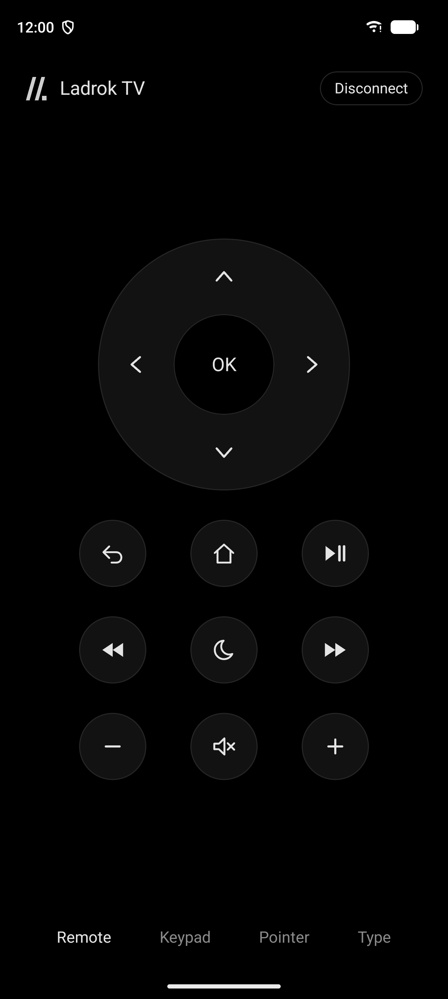
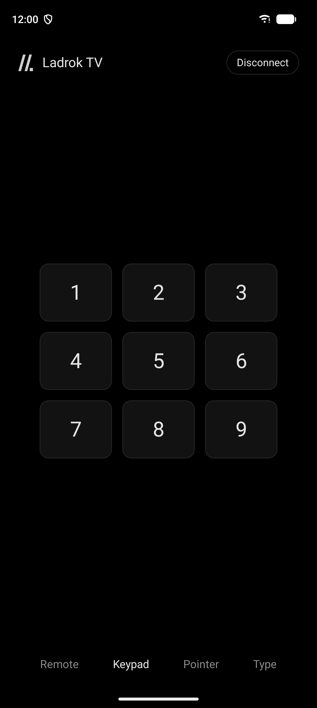
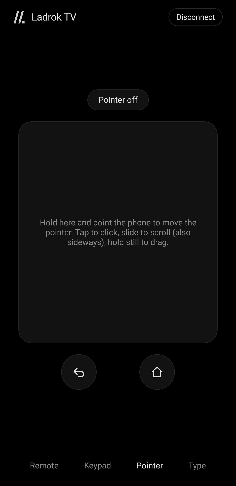
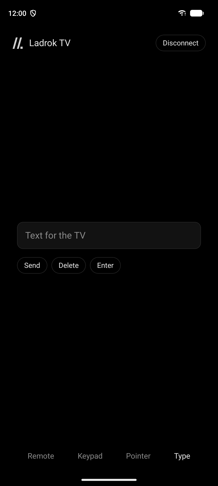

<p align="center"></p>

# Ladrok Remote

A remote control for [Ladrok TV](https://github.com/Kordal/ladrok-tv) on your phone, over Bluetooth. The arrows and OK, Back and Home, playback and volume, the sleep timer, the Launcher's Keypad (1–9 open your apps), the Pointer (a trackpad for a mouse pointer on the TV, or an air mouse, in Settings), and Type, for search boxes. Nothing else.

<p align="center">
  
  
  
  
</p>

The phone acts as a Bluetooth keyboard and remote, so the TV sees an ordinary Bluetooth accessory. Minimized, the app stays connected to the TV, with a notification to Disconnect. Settings (the gear) has Disconnect too, and can switch staying connected to only while the app is open. While the phone is connected it counts as a keyboard, so the TV doesn't show its own on-screen one.

Terms are defined in [CONTEXT.md](CONTEXT.md), decisions in [docs/adr](docs/adr), the keys in [docs/protocol.md](docs/protocol.md).

## Install

On an Android phone (Android 12 or newer), download `LadrokRemote.apk` from the [latest release](https://github.com/Kordal/ladrok-remote/releases/latest) and open it. Allow installing from your browser or file manager when asked.

## Pair

1. On the TV: Settings › Remotes & Accessories › Add accessory.
2. In the Remote: *Pair a TV*, then choose the TV.
3. Check the code is the same on both, and confirm on both.

After that the Remote connects to the same TV whenever it opens.

The TV makes the first connection after pairing (Ladrok TV's LadrokRemoteHelper, in builds from 20261016.2352 on, see [ADR 0001](docs/adr/0001-the-remote-is-a-bluetooth-keyboard.md)). A stock Android TV doesn't, so there the Remote pairs but its keys are refused.

## Status

- Unit-tested: the HID reports and descriptor, the Link state machine, which devices count as TVs.
- Tried on emulators: permissions, search, pairing with an Android TV emulator, which then refuses the keys (a stock Android TV).
- Tried on a phone with a Ladrok TV (Pi 5) on 2026-10-17: pairs, and the arrows and OK move focus on the TV.
- Not tried yet: reconnecting when the Remote is reopened, or after the TV reboots; the other Keys and Type on a Ladrok TV.

## Build and run

You need the Android SDK and JDK 21 or newer (the one bundled with Android Studio works). The Android app is in `android/`; the iOS one will go next to it.

```bash
cd android
./gradlew testDebugUnitTest   # HID reports, Link, TVs
./gradlew installDebug        # onto a connected phone (Android 12 or newer)
```

Emulators have no shared Bluetooth with real devices; use a phone.

## Releases

Run Actions › Release › Run workflow with a version such as `v1.0.0` (or push that tag). CI builds `LadrokRemote.apk`, signs it with the Launcher's release key (repo secrets, the same as ladrok-start's: `LADROK_KEYSTORE_B64` and `LADROK_KEYSTORE_PASSWORD`) and attaches it with its SHA-256 to a GitHub Release.

## License

Apache License 2.0, see [LICENSE](LICENSE).
